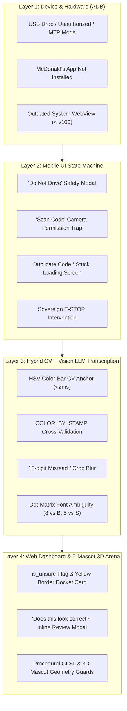

# 🛡️ Play-McNopoly: Error Handling & Troubleshooting Guide

This guide documents the multi-layered defensive error-handling architecture of **Play-McNopoly**, covering Android ADB hardware recovery, Vision LLM + Color-Bar CV cross-validation, and procedural 3D WebGL mascot diagnostics.

---

## 🏛️ Multi-Layered Error Architecture



---

## 📱 Mobile & ADB Failure Modes

### 1. The "Jumping Mr. Monopoly" Infinite Loading Screen
* **Symptom**: The McDonald's app launches, but tapping *"Play Now"* stays stuck forever on the jumping Mr. Monopoly animation.
* **Root Cause**: **Outdated Android System WebView**. The 2026 Monopoly portal is an embedded modern HTML5/WebSocket WebView that requires modern JavaScript APIs (ES2022+) and TLS cyphers. Older devices (e.g. Galaxy S8+ running Chromium 79) cannot parse the modern JavaScript bundle.
* **Diagnosis Command**:
  ```bash
  adb shell dumpsys webviewupdate
  ```
* **Resolution**:
  - Update **Android System WebView** (`com.google.android.webview`) via Google Play Store or Aurora Store to **version 110 or higher**.

---

### 2. Device Drops Out to MTP Mode / Samsung Auto Blocker Disables USB Debugging
* **Symptom**: `adb devices` returns an empty list (and the **Redeem via ADB** button disables), even though the phone is plugged in via USB and `mtp://` file transfer is active (`04e8:6860 Samsung Electronics Co., Ltd Galaxy series, misc. (MTP mode)`).
* **Root Cause (Newer Samsung One UI 6.x+ Devices, e.g., Galaxy S23)**:
  - **Samsung Auto Blocker** (*Settings $\rightarrow$ Security and Privacy $\rightarrow$ Auto Blocker*) blocks ADB commands over USB and forces **USB Debugging** off. If a mobile device drops out or resets its USB state while Auto Blocker is active, USB Debugging must be re-enabled after turning Auto Blocker off.
* **Automated Telemetry Detection ([`automation/adb_manager.py`](file:///home/metanet/Pictures/Play-McNopoly/automation/adb_manager.py))**:
  - When `adb devices` is empty, `get_status()` checks `lsusb` for connected Android USB Vendor IDs (`04e8:`, `18d1:`, `22b8:`, `2717:`) and sets `"usb_mtp_only": True`, changing the navbar status pill from `"No Phone"` to **`⚠️ USB Debug Off (Auto Blocker)`**.
* **Resolution**:
  1. On newer Samsung devices, go to **Settings $\rightarrow$ Security and Privacy $\rightarrow$ Auto Blocker** and ensure **Auto Blocker** is turned **OFF**.
  2. Navigate to **Settings $\rightarrow$ Developer Options**, toggle **USB Debugging** back **ON**, and tap **Always allow** on the RSA prompt.
  3. Verify on host: `adb devices -l` (or restart server via `adb kill-server && adb start-server`).

---

### 3. McDonald's App Not Installed (Fresh Device Setup)
* **Symptom**: Automation crashes with `Activity class does not exist`.
* **Automation Handling**: `adb_manager.py` performs a package preflight check (`adb shell pm path com.mcdonalds.superapp`) and automatically deep-links to Aurora Store, Galaxy Store, or Google Play if missing.

---

### 4. Unexpected UI Modals & Popups
* **Automation Handling**: `automation/adb_manager.py` inspects the active UI hierarchy (`uiautomator dump`):
  - **Safety Warning ("Do Not Text and Drive")**: Automatically dismissed by clicking `OK`.
  - **Camera Permission Prompt**: Automatically clicks *"Add Code Manually"*.
  - **Duplicate Piece Card**: Automatically clicks *"Add New Code"* to stay inside the portal.

---

### 5. Emergency Stop (Sovereign E-STOP)
* **Button Lifecycle**:
  - **Idle State**: Disabled (`disabled="true"`) across both Desktop and Mobile portals to prevent false triggers.
  - **Armed State**: Immediately enabled and pulsing red while `/api/adb/status/` reports `is_running: true`.
* **Behavior**: Sets `threading.Event()`, terminates pending `uiautomator` commands, stops typing, and leaves the phone untouched.

---

## 🤖 Hybrid Vision OCR & Color-Bar CV Failure Modes

### 1. VLM Property / Stamp Number Hallucinations Across Color Sets
* **Symptom**: A Vision LLM misreads a small stamp number (e.g., reading `#815` Yellow instead of `#818` Green) or fails to read upside-down perimeter spaces on the game board PDF.
* **Defensive Handling**:
  - **Deterministic HSV Color-Bar Anchor ([`game/extractor.py`](file:///home/metanet/Pictures/Play-McNopoly/game/extractor.py))**: `detect_color_bar_from_image()` measures the median HSV hue/saturation/value of the top header band in $<2\text{ms}$ and cross-checks against `COLOR_BY_STAMP`. Any mismatch between the VLM's stamp number and the physical color bar automatically sets `is_unsure = True`.
  - **4-Quadrant Rotational PDF Sync ([`automation/sync_board_from_pdf.py`](file:///home/metanet/Pictures/Play-McNopoly/automation/sync_board_from_pdf.py))**: Slices the 4 outer edges of `dataset/MONOPOLY-gameboard.pdf` and rotates them upright ($0^\circ, 90^\circ, 180^\circ, 270^\circ$) before OCR so the VLM never reads sideways or upside-down text.

### 2. 13-Character or Unsure Codes (`is_unsure = True`)
* **Symptom**: A dot-matrix code is transcribed with 13 characters instead of 14, or the piece is torn/blurred.
* **Automation Handling**: Highlighted with a **Yellow Border** and **❓ Unsure** badge in the web docket and excluded from auto-entry until confirmed via the inline review modal.

### 3. Mobile Camera Multi-Stamp Upload Returning `"Extracted 1 Stamp"` (Blank Code)
* **Symptom**: Snapping a high-resolution mobile camera photo (`4000×3000`) containing multiple game pieces returns `"Extracted 1 Stamp"` with a filename label and blank code.
* **Root Cause**:
  1. Mobile camera photos store rotation in EXIF metadata (`Orientation = 6` for $90^\circ$ clockwise), sending sideways images to the Vision LLM if raw file bytes are base64-encoded directly.
  2. If the configured `LM_STUDIO_VISION_MODEL` (`qwen3-vl-8b-instruct`) is unloaded in LM Studio while `qwen3-vl-4b-instruct` is active, an `HTTP 400` exception triggered the single-item fallback placeholder.
* **Fix Implemented ([`game/extractor.py`](file:///home/metanet/Pictures/Play-McNopoly/game/extractor.py))**:
  - Applies `ImageOps.exif_transpose()` and downscales images $>1500\text{px}$ to crisp JPEG before base64 encoding.
  - Iterates across `FALLBACK_VISION_MODELS` (`qwen3-vl-4b-instruct`, `qwen3-vl-8b-instruct`, `qwen3-4b-vl`, `qwen3-8b-vl`) with `max_tokens=1024` and explicit multi-piece array instructions.

### 4. Clicking `"Redeem via ADB"` From the Mobile Device's Own Browser
* **Symptom**: Tapping **🚀 Redeem via ADB** while viewing the web UI in Chrome on the connected Android phone itself causes ADB to tap coordinates inside Chrome instead of the McDonald's App.
* **Fix Implemented ([`automation/adb_manager.py`](file:///home/metanet/Pictures/Play-McNopoly/automation/adb_manager.py))**:
  - `get_screen_state()` checks the active window dump for browser packages (`com.android.chrome`, `org.mozilla.firefox`, `com.sec.android.app.sbrowser`) and returns `"IN_BROWSER"`.
  - `ensure_manual_entry()` automatically launches the McDonald's App (`adb shell monkey -p <pkg> -c android.intent.category.LAUNCHER 1`) to foreground it over Chrome before navigating into the Monopoly manual code entry screen.

---

## 🎭 3D WebGL Mascot & Procedural Shader Failure Modes

| Symptom | Root Cause | Fix Implemented |
| :--- | :--- | :--- |
| **Grimace eyelids cover pupils constantly** | Eyelid hemisphere `thetaLength` too large (`0.50π`) and resting angle too low | Reduced `thetaLength` to `0.38π` and raised resting `lid.rotation.x = 0.22` in [`grimace-mesh.js`](file:///home/metanet/Pictures/Play-McNopoly/game/static/game/js/grimace/grimace-mesh.js). |
| **Yellow feather line or gap at Birdie's chest/bib junction** | `CylinderGeometry` bib tapered narrower than `overallGeo` at `y = 0.24`, allowing 14 feather shells (`uShell * uLen`) to poke through the front seam | Extended `chestProfile` down to `y = 0.16` for gap-free side wings, recessed front lower-chest vertices (`-0.065` in $Z$) with a `faceRadius` mask, and matched `bibGeo` bottom radius (`0.587`) flush with `overallGeo` in [`birdie-mesh.js`](file:///home/metanet/Pictures/Play-McNopoly/game/static/game/js/mascot/birdie-mesh.js). |
| **Mascot fails to appear when selected (`TypeError: Cannot read properties of undefined (reading 'set')`)** | Calling `.position.set(x, y, z)` on a `THREE.BufferGeometry` instance instead of a `THREE.Mesh` | Always use `.translate(x, y, z)` on `BufferGeometry` or `.position.set(x, y, z)` on `THREE.Mesh` (fixed in [`ronald-mesh.js`](file:///home/metanet/Pictures/Play-McNopoly/game/static/game/js/mascot/ronald-mesh.js) and [`monopoly-mesh.js`](file:///home/metanet/Pictures/Play-McNopoly/game/static/game/js/mascot/monopoly-mesh.js)). |
| **Tall headgear (Mr. Monopoly's Top Hat) clipped at top of arena** | `mascot-core.js` idle bob overwrote `mascotObj.root.position.y = Math.sin(...)` around `0.0` every frame | Added `mascotObj.baseY` preservation in [`mascot-core.js`](file:///home/metanet/Pictures/Play-McNopoly/game/static/game/js/mascot/mascot-core.js) and set `baseY: -0.24` (`scale = 0.88`) in [`monopoly-mesh.js`](file:///home/metanet/Pictures/Play-McNopoly/game/static/game/js/mascot/monopoly-mesh.js). |
| **Floating particles appear mostly purple despite multi-color array** | Canvas radial gradient texture in `grimace-particles.js` had hardcoded purple color stops multiplied against `vertexColors` | Replaced with a pure neutral-white radial gradient (`rgba(255,255,255,*)`) and an 11-color multi-character palette in [`grimace-particles.js`](file:///home/metanet/Pictures/Play-McNopoly/game/static/game/js/grimace/grimace-particles.js). |
| **3D Mascot canvas pushed off-screen right on mobile (`< 900px`)** | `#board-status-ticker` (`white-space: nowrap`) inside a CSS Grid item without `min-width: 0` expanded `.mascot-arena-box` to `~620px` wide on a `360px` phone viewport | Added `min-width: 0; max-width: 100%;` to `.mascot-arena-box` and allowed `#board-status-ticker` to wrap on mobile in [`index.html`](file:///home/metanet/Pictures/Play-McNopoly/game/templates/game/index.html). |

---

## 🔍 Diagnostic Cheatsheet

```bash
# Seed or reset the 40 official Canadian board spaces
python3 manage.py seed_board

# Verify 3D mascot rendering headlessly (Grimace, Birdie, Hamburglar, Ronald, Mr. Monopoly)
google-chrome --headless --disable-gpu --window-size=1400,1050 --virtual-time-budget=3000 --screenshot=/tmp/mascot_check.png "http://localhost:8085/#monopoly-monocle"

# Dry-run 4-quadrant PDF board calibration
python3 automation/sync_board_from_pdf.py --pdf dataset/MONOPOLY-gameboard.pdf --dry-run

# Check connected ADB devices & WebView version
adb devices -l
adb shell "dumpsys webviewupdate | grep 'Current WebView package'"

# Run non-destructive dry-run ADB entry
python3 automation/cli_runner.py --dry-run
```
